<a href="https://abdelmonem.dev">
  <picture>
    <source media="(prefers-color-scheme: dark)" srcset="./assets/header-dark.svg">
    <source media="(prefers-color-scheme: light)" srcset="./assets/header-light.svg">
    
  </picture>
</a>

<div align="center">

[;Clean+Architecture+%C2%B7+BLoC+%C2%B7+test-first+Flutter;Government+platforms+in+Egypt+and+Saudi+Arabia;Open+to+remote+roles+and+relocation)](https://abdelmonem.dev)

[](https://abdelmonem.dev)
[](https://linkedin.com/in/abdelmonemrabea)
[](mailto:abdelmonem.developer@gmail.com)
[](https://wa.me/201111239035)

</div>

## 👋 About me

I'm a senior mobile engineer who ships Flutter apps end to end — architecture, code, tests, store releases and production triage. Over 5+ years I've built **40+ apps** for clients in **7 countries** across Egypt, the Gulf, Europe and Australia, including **government platforms** in Egypt and Saudi Arabia, with **500K+ installs** on Android and iOS.

```dart
final class Abdelmonem extends SeniorMobileEngineer {
  @override
  final role = 'Lead Mobile Engineer @ Event Masters';

  final base = 'Egypt 🇪🇬 · UTC+2';
  final openTo = ['remote', 'relocation'];
  final shipped = (apps: 40, installs: '500K+', countries: 7);
  final stack = ['Flutter', 'Dart 3', 'BLoC', 'Clean Arch'];
  final speaks = ['Arabic', 'English'];

  List<String> get strengths => [
        'Arabic-first products with full RTL',
        'White-label builds from one codebase',
        'End-to-end release ownership',
        'Test-first, CI-enforced quality',
      ];
}
```

**🔭 Right now**

- Leading mobile at **Event Masters** — a 7-app workforce platform (5 live, 2 in development)
- Shipping client apps for Egypt, Ireland, Spain and Australia with **Addicta**
- Building AI-assisted: Claude Code with project rules, test-first workflows and review gates

## 📈 By the numbers — Event Masters

<table>
  <tr>
    <td align="center" valign="top" width="25%"><h3>93%</h3><sub>of 2,064 commits across all 7 apps</sub></td>
    <td align="center" valign="top" width="25%"><h3>270k</h3><sub>lines of Dart · 350+ screens · 190+ Cubits</sub></td>
    <td align="center" valign="top" width="25%"><h3>2,000+</h3><sub>automated tests in 2026, up from almost none</sub></td>
    <td align="center" valign="top" width="25%"><h3>250K+</h3><sub>iOS installs on the flagship app</sub></td>
  </tr>
  <tr>
    <td align="center" valign="top"><h3>−40%</h3><sub>release cycle time with GitHub Actions + Shorebird OTA</sub></td>
    <td align="center" valign="top"><h3>~½</h3><sub>Android download size, down from 54.9 MB</sub></td>
    <td align="center" valign="top"><h3>502</h3><sub>audit findings turned into a 90-task, 6-phase plan</sub></td>
    <td align="center" valign="top"><h3>en · ar · fr</h3><sub>white-label builds from one config-driven codebase</sub></td>
  </tr>
</table>

## 🚀 Featured work

<table>
  <tr>
    <td width="50%" valign="top">
      <h3>👥 Event Masters Suite</h3>
      <sub><b>WORKFORCE MANAGEMENT · SAUDI ARABIA</b></sub>
      <p>7-app platform for event staffing. I rebuilt the flagship app from scratch: KYC onboarding, on-ground attendance, payslips, e-signed agreements and a training academy, with biometric login and real-time updates over Socket.IO.</p>
      <p>📲 <b>12K+</b> Android · <b>250K+</b> iOS installs</p>
      <a href="https://abdelmonem.dev/work/event-masters-suite">Case study →</a>
    </td>
    <td width="50%" valign="top">
      <h3>🇸🇦 Mutawwifs</h3>
      <sub><b>GOVERNMENT · MINISTRY OF HAJJ AND UMRAH</b></sub>
      <p>Field app, Coordinating Council app and two dashboards: group tracking, wristband identification and field coordination at Masjid al-Haram. Arabic-first with full RTL.</p>
      <p>🏛️ Built for the Saudi Ministry of Hajj and Umrah</p>
      <a href="https://abdelmonem.dev/work/mutawwifs-ministry-of-hajj">Case study →</a>
    </td>
  </tr>
  <tr>
    <td width="50%" valign="top">
      <h3>🇪🇬 Egypt Auctions</h3>
      <sub><b>GOVERNMENT · EGYPT</b></sub>
      <p>National auction platform with real-time bid streaming over Socket.IO and FCM.</p>
      <p>📲 <b>13K+</b> Android installs</p>
      <a href="https://abdelmonem.dev/work/egypt-auctions">Case study →</a>
    </td>
    <td width="50%" valign="top">
      <h3>🇪🇬 Egypt Real Estate</h3>
      <sub><b>GOVERNMENT · EGYPT</b></sub>
      <p>National real-estate platform with Banque Misr mortgage integration.</p>
      <p>📲 <b>13K+</b> Android installs in its first 11 months</p>
      <a href="https://abdelmonem.dev/work/egypt-real-estate">Case study →</a>
    </td>
  </tr>
</table>

**Also shipped:** InPerson (HR & community platform) · Peel (fitness marketplace, Spain) · StatDoctor (hospital shifts, Australia) · CairoScan (5.8K+ installs) · Dog Drive (4.2K+) · Hatly Vendor · Remontada FC

## 🛠️ Tech stack

<p align="center">
  
</p>

- **Flutter & Dart** — Dart 3, BLoC/Cubit, Clean Architecture (feature-first), get_it, Dio, Hive, sealed states, Either-based error handling
- **Native & device** — Kotlin, Swift/SwiftUI, Platform Channels, Dart FFI, NFC, QR scanning, biometrics, Google Maps, geofencing
- **Data & real-time** — REST, GraphQL, Socket.IO, WebSockets, Firestore, FCM, encrypted local storage
- **Quality & delivery** — flutter_test, bloc_test, mocktail, GitHub Actions, Shorebird OTA, Fastlane, Codemagic, Sentry, Crashlytics
- **Product** — Arabic / English / French localization and RTL, white-label flavors, Stripe, RevenueCat, App Store & Google Play compliance

## 💼 Experience

**Event Masters** · Riyadh, Saudi Arabia · remote contract &nbsp;`Aug 2024 – present`<br>
Lead Mobile Engineer since Jan 2025 · joined as Senior Flutter Developer

- Primary engineer across all 7 apps; reviewed and merged work from 4 contributors, and led 3 developers on Promofiy and Seha Pods
- Rebuilt the flagship app (v1 → v2, now build 114): 104 screens, 120+ REST endpoints
- Designed a white-label accreditation platform — digital badges, geofenced attendance, zone access — released under each client's own store accounts
- Built the release pipeline (static analysis, tests, release builds, Sentry symbols) and Shorebird OTA hotfixes on 4 apps
- Kept every app store-compliant through Android 16 / targetSdk 36, AGP, Gradle, Kotlin and Xcode migrations; own production triage in Sentry and Crashlytics

**Addicta** · Egypt & international clients · part-time &nbsp;`Nov 2023 – present`<br>
Senior Flutter Developer

- Sole mobile engineer on **InPerson** (live on both stores): 89 screens, 90+ endpoints, 11 modules, 190+ tests; led the chat migration to Firestore
- **Peel** (Spain): RevenueCat subscriptions, a native TikTok SDK bridge over Platform Channels, FFmpeg video compression
- **StatDoctor** (Australia): payments, analytics SDKs and social auth
- Modernized inherited apps without pausing releases: staged upgrades, tests before refactoring

<details>
<summary><b>Earlier — Dubisign · H Solutions</b></summary>
<br>

**Dubisign** · Saudi Arabia & UAE &nbsp;`Jul 2022 – Nov 2023`<br>
Flutter Developer, promoted to Senior Flutter Developer (Feb 2023)

- Mutawwifs suite for the Saudi Ministry of Hajj and Umrah
- Introduced CI/CD for automated store distribution and drove Clean Architecture adoption by refactoring in place
- Custom animations and painters; certificate pinning and token-based auth

**H Solutions** · Egypt &nbsp;`May 2021 – Jul 2022`<br>
Flutter Developer

- Production apps with Google Maps, REST APIs and Stripe, including geofenced attendance check-in (100 m radius on a debounced location stream)
- Reduced crash rates through Crashlytics monitoring and root-cause fixes

</details>

## 📊 GitHub activity

<div align="center">

<picture>
  <source media="(prefers-color-scheme: dark)" srcset="https://raw.githubusercontent.com/3bdelmonem/3bdelmonem/output/github-snake-dark.svg">
  <source media="(prefers-color-scheme: light)" srcset="https://raw.githubusercontent.com/3bdelmonem/3bdelmonem/output/github-snake.svg">
  
</picture>

<picture>
  <source media="(prefers-color-scheme: dark)" srcset="https://streak-stats.demolab.com/?user=3bdelmonem&hide_border=true&background=0D1117&stroke=30363D&ring=56C2FF&fire=56C2FF&currStreakNum=E6EDF3&sideNums=E6EDF3&currStreakLabel=56C2FF&sideLabels=8D9BB0&dates=8D9BB0">
  <source media="(prefers-color-scheme: light)" srcset="https://streak-stats.demolab.com/?user=3bdelmonem&hide_border=true&background=FFFFFF&stroke=D0D7DE&ring=0B74D1&fire=0B74D1&currStreakNum=0D1726&sideNums=0D1726&currStreakLabel=0B74D1&sideLabels=56657A&dates=56657A">
  
</picture>

<picture>
  <source media="(prefers-color-scheme: dark)" srcset="https://github-readme-activity-graph.vercel.app/graph?username=3bdelmonem&bg_color=0D1117&color=8D9BB0&title_color=E6EDF3&line=56C2FF&point=E6EDF3&area=true&area_color=56C2FF&hide_border=true&custom_title=Contributions%20in%20the%20last%2031%20days">
  <source media="(prefers-color-scheme: light)" srcset="https://github-readme-activity-graph.vercel.app/graph?username=3bdelmonem&bg_color=FFFFFF&color=56657A&title_color=0D1726&line=0B74D1&point=0D1726&area=true&area_color=0B74D1&hide_border=true&custom_title=Contributions%20in%20the%20last%2031%20days">
  
</picture>

<sub>Most of my work lives in private client repositories — the graph counts those contributions too.</sub>

</div>

## 🎓 Education

**BSc Computer and Information Sciences** · Mansoura University, Egypt &nbsp;`2018 – 2022`<br>
🏆 Best Graduation Project Award 2022 — AI and ML food recommendation system (graded Excellent)

<details>
<summary><b>Courses & certificates</b></summary>
<br>

- Natural Language Processing — 2022
- Game Development Training — Unity 2D & 3D, score 90% (2021)
- The Complete Flutter & Dart Development Guide — Udemy
- Deep Dive into Clean Architecture in Flutter — Udemy
- Flutter TDD Clean Architecture — Reso Coder
- Flutter Payment Integration: Stripe, PayPal & More — Udemy

</details>

## 🤝 Let's work together

I'm open to **senior and lead mobile roles** — remote, or relocation for the right team. The fastest way to reach me is [email](mailto:abdelmonem.developer@gmail.com) or [LinkedIn](https://linkedin.com/in/abdelmonemrabea), and you'll find case studies at [abdelmonem.dev](https://abdelmonem.dev).

<div align="center">
<br>

*"Ship it. Iterate. Repeat."*


</div>
